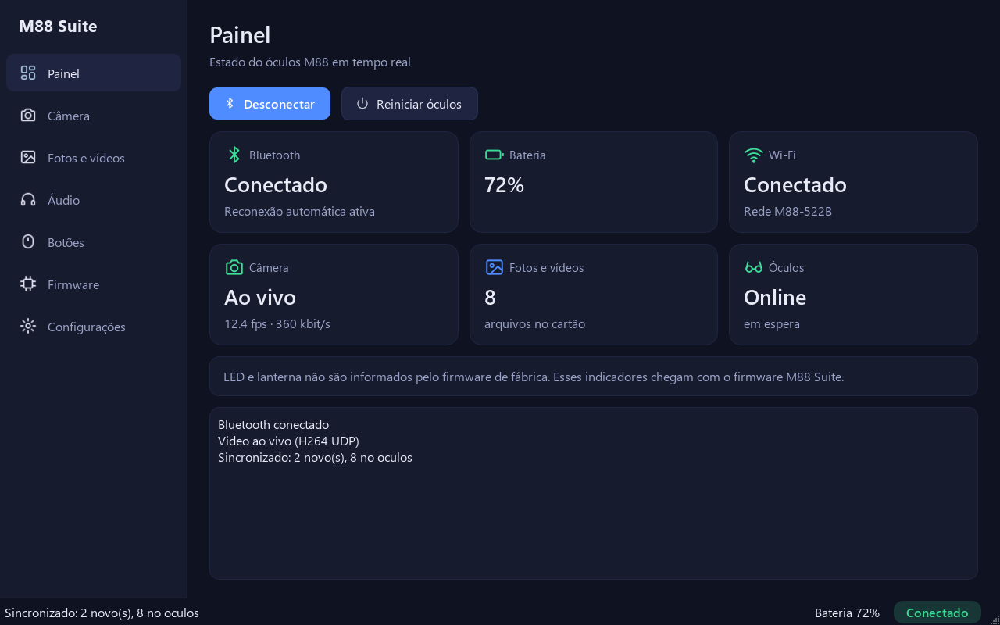
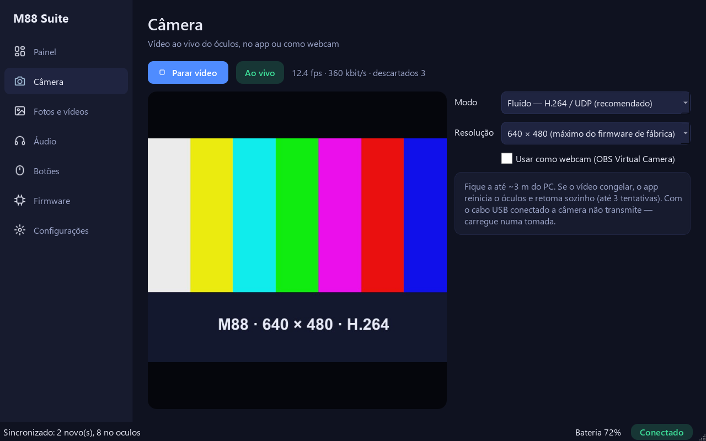

# M88 Suite

Software de controle aberto para o **óculos inteligente M88** (SoC Beken **BK7258**), para
**Windows** e **Android**: vídeo ao vivo da câmera, uso como **webcam**, sincronização de fotos e
vídeos, telemetria do óculos e reconexão automática — funcionando com o **firmware de fábrica**.



> Projeto independente, sem relação com o fabricante do M88 nem com a Beken. O protocolo foi
> obtido por engenharia reversa para interoperabilidade com um aparelho próprio. Use por sua conta
> e risco.

## Recursos

| | Windows | Android |
|---|:---:|:---:|
| Conexão Bluetooth LE com reconexão automática | ✅ | ✅ |
| Painel: bateria, Bluetooth, Wi‑Fi, câmera, nº de arquivos, estado do óculos | ✅ | ✅ |
| Vídeo ao vivo (H.264/UDP, H.264/TCP ou JPEG) com fps e banda | ✅ | ✅ |
| Recuperação do vídeo congelado (reinicia o óculos e retoma) | ✅ | ✅ |
| Webcam virtual para Meet/Zoom/Teams/OBS | ✅ | — ¹ |
| Copiar fotos e vídeos novos do óculos (galeria/pasta) | ✅ | ✅ |
| Reiniciar o óculos remotamente | ✅ | ✅ |
| Fone de ouvido e microfone | ✅ ² | ✅ ² |

¹ O Android não permite que apps publiquem uma câmera para outros apps sem root.
² Pelo Bluetooth do sistema (o óculos é um headset A2DP/HFP); o app mostra os atalhos.



## Instalação

### Windows
1. Baixe `M88Suite-<versão>-windows.zip` na página de **Releases**, extraia e abra **`M88Suite.exe`**.
2. Ligue o Bluetooth e o Wi‑Fi do PC. O óculos deve estar ligado e **sem** o Bluetooth do celular
   conectado nele.
3. Para usar como webcam, instale o [OBS Studio](https://obsproject.com/) (o app usa o driver
   "OBS Virtual Camera"; não é preciso configurar nada no OBS) e marque **Usar como webcam** na
   aba Câmera. Nos apps de reunião, escolha **OBS Virtual Camera**.

Rodar do código‑fonte ou gerar o EXE: [desktop/README.md](desktop/README.md).

### Android (13+)
Baixe o APK na página de **Releases** (ou gere com `android\gradlew.bat :app:assembleRelease`) e
instale. Se o app não encontrar o óculos, veja **Problemas conhecidos** em
[android/README.md](android/README.md) — no Android alguns apps esgotam as conexões Bluetooth LE.

## Dicas de uso

- Alcance útil do vídeo: **até ~3 m**. Um adaptador Wi‑Fi USB separado no PC ajuda bastante
  (o rádio interno divide Wi‑Fi e Bluetooth) — ver [docs/HARDWARE.md](docs/HARDWARE.md).
- **Com o cabo USB conectado a câmera não transmite** (o firmware de fábrica entra em modo pen
  drive). Carregue numa tomada enquanto usa o vídeo.
- O firmware de fábrica abre o serviço de vídeo **uma vez por ligação**; o app reinicia o óculos
  sozinho quando precisa.

## Limites do firmware de fábrica

640 × 480, ~5–13 fps (depende do sinal), sem informação de LED/lanterna, atalhos dos botões fixos,
sem atualização de firmware segura (não há como fazer backup da versão instalada sem conexão serial).
O caminho para um firmware próprio está em [docs/FIRMWARE_UPDATE.md](docs/FIRMWARE_UPDATE.md) e no
[roadmap](docs/ROADMAP.md).

## Como funciona

```
        Bluetooth LE (controle, telemetria, reinício)
PC / celular  ───────────────────────────────────────►  M88 (BK7258, firmware de fábrica)
        Wi‑Fi do próprio óculos (AP "M88-522B")
              ◄─── vídeo H.264/JPEG (UDP 7180 / TCP 7150), comandos TCP 7100, fotos via FTP
```

- **Controle:** protocolo BLE do SDK do fabricante (frames `0x54`) + serviço de configuração da Beken.
- **Vídeo:** o firmware de fábrica já traz o serviço "doorbell" do SDK da Beken, desligado; o app
  o liga pelo Bluetooth e fala o protocolo dele.
- **Mídia:** servidor FTP do próprio óculos.

Tudo documentado em [docs/PROTOCOL.md](docs/PROTOCOL.md) e [docs/ARCHITECTURE.md](docs/ARCHITECTURE.md).

## Estrutura do repositório

| Pasta | Conteúdo |
|---|---|
| [`desktop/`](desktop) | App Windows — Python 3.11+, PySide6, bleak (BLE/WinRT), PyAV, pyvirtualcam |
| [`android/`](android) | App Android — Kotlin, Jetpack Compose; módulo `:core` em Kotlin puro |
| [`protocol/`](protocol) | Vetores de teste compartilhados entre as implementações |
| [`docs/`](docs) | Arquitetura, protocolos, hardware, atualização de firmware, roadmap |
| `firmware/` | Reservado para o firmware M88 Suite (planejado) |

## Desenvolvimento

```bash
# Windows (na pasta desktop)
python -m venv .venv
.venv\Scripts\python -m pip install -e ".[dev]"
.venv\Scripts\python -m pytest              # testes do núcleo
.venv\Scripts\python -m m88suite.app        # abre o app

# Android (na pasta android)
gradlew.bat :core:test :app:assembleDebug
```

Os vetores em `protocol/vectors.json` são gerados pela implementação Python
(`python protocol/gen_vectors.py`) e verificados pelos testes Python e Kotlin.

## Créditos

- O protocolo de vídeo segue o serviço *doorbell* dos SDKs da Beken
  ([bk_avdk](https://github.com/bekencorp/bk_avdk), [bk_solution_doorbell](https://github.com/bekencorp/bk_solution_doorbell),
  licença Apache‑2.0); a tabela CRC8 em `doorbell.py`/`Doorbell.kt` vem desse código.
- Pinagem do chip: datasheet Beken DS‑BK7258‑E13 V2.2.

## Licença

[MIT](LICENSE). A tabela CRC8 e o formato do protocolo de vídeo derivam de código Apache‑2.0 da Beken
(ver Créditos).
